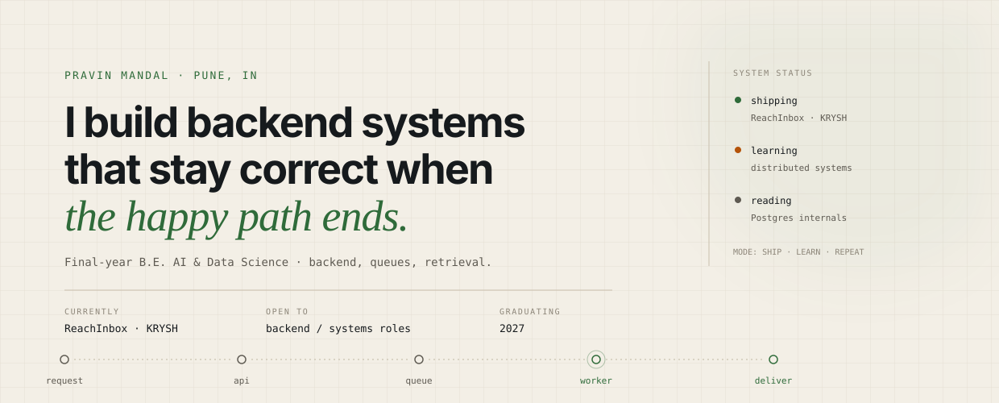
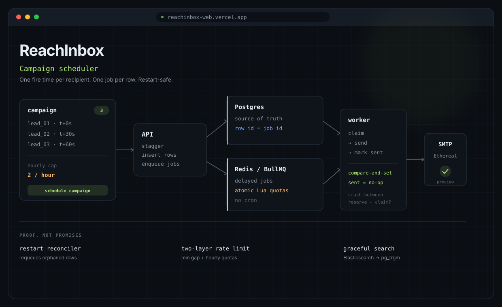
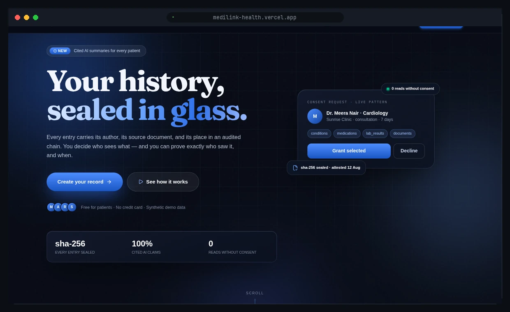
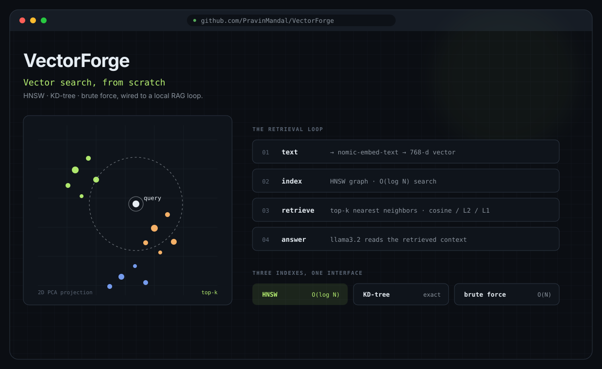
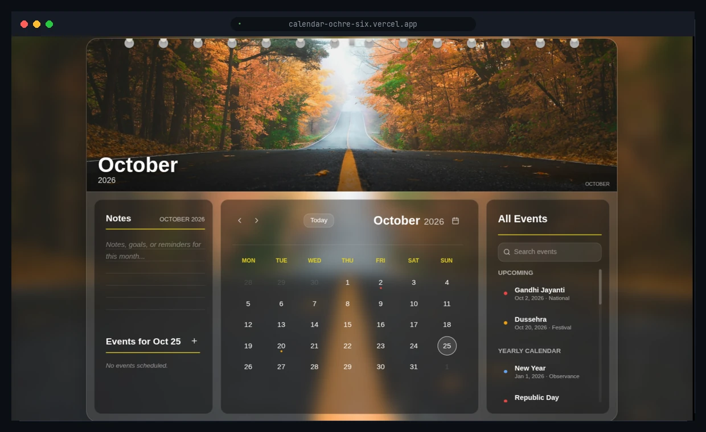

<picture>
  <source media="(prefers-color-scheme: dark)" srcset="assets/hero-dark.svg">
  <source media="(prefers-color-scheme: light)" srcset="assets/hero-light.svg">
  
</picture>

### The short version

Final-year **AI & Data Science** student at Ajeenkya DY Patil School of Engineering, Pune. I build backend systems and the interfaces around them — mostly with TypeScript, Postgres, Redis, and C++ when the problem calls for it.

I care about the parts that don't make the demo: idempotency, retries, schema design, and what happens when the process dies mid-write.

### Selected work

<table>
<tr>
<td width="50%" valign="top">

 
<strong>ReachInbox</strong> — campaign scheduler with restart-safe sends
 
TypeScript · BullMQ · Postgres · Redis
 
<a href="https://reachinbox-web.vercel.app">live</a> · <a href="https://github.com/PravinMandal/ReachInbox">code</a>
</td>
<td width="50%" valign="top">

 
<strong>MediLink</strong> — consent-gated health records with a hash-chained audit trail
 
Next.js · Postgres · DPDP · Vitest
 
<a href="https://medilink-health.vercel.app">live</a> · <a href="https://github.com/PravinMandal/MediLink">code</a>
</td>
</tr>
<tr>
<td width="50%" valign="top">

 
<strong>VectorForge</strong> — vector database from scratch in C++: HNSW, KD-tree, RAG
 
C++ · React · Ollama
 
<a href="https://github.com/PravinMandal/VectorForge">code</a>
</td>
<td width="50%" valign="top">

 
<strong>Calendar</strong> — VisionOS-inspired calendar with CSS 3D page physics
 
React · SCSS · date-fns
 
<a href="https://calendar-ochre-six.vercel.app">live</a> · <a href="https://github.com/PravinMandal/Calendar">code</a>
</td>
</tr>
</table>

### LeetCode

  

### Now

- **Building** — [ReachInbox](https://github.com/PravinMandal/ReachInbox) and **KRYSH** (private), a git-backed memory engine for long-running AI mentorship.
- **Learning** — distributed systems, Postgres internals, and system design.
- **Open to** — backend / systems / platform engineering roles for 2027. Pune, Bangalore, or remote.

### Toolbox

**Languages** — C++ · TypeScript · JavaScript · Python · SQL  
**Backend** — Node.js · Express · PostgreSQL · Redis · BullMQ · Prisma · MongoDB  
**Frontend** — React · Next.js · Tailwind · SCSS  
**Infra** — Docker · Vercel · GitHub Actions · Linux

### More work

[TaskFlow](https://github.com/PravinMandal/taskflow) · [GrowEasy CSV importer](https://github.com/PravinMandal/GrowEasy-Assignment) · [macOS portfolio](https://github.com/PravinMandal/Mac_OS) · [Job portal API](https://github.com/PravinMandal/job-portal-api)

### Let's talk

I'm looking for a team where I can own backend services and learn from people who care about the failure path.

[Email](mailto:pravinmandalp45@gmail.com) · [LinkedIn](https://www.linkedin.com/in/pravinmandal/) · [LeetCode](https://leetcode.com/u/PravinMandal/) · [GitHub](https://github.com/PravinMandal)

Build it so it survives the restart.

