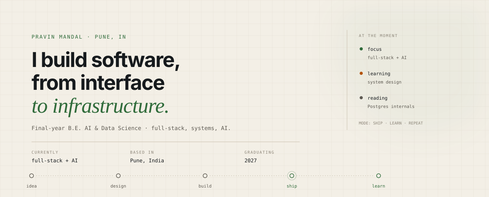

<picture>
  <source media="(prefers-color-scheme: dark)" srcset="assets/hero-dark-3.svg">
  <source media="(prefers-color-scheme: light)" srcset="assets/hero-light-3.svg">
  
</picture>

### The short version

Final-year **AI & Data Science** student at Ajeenkya DY Patil School of Engineering, Pune. I build full-stack applications and enjoy the parts that make them reliable — data modeling, clean interfaces, and the occasional deep dive into how things work under the hood.

### Tech Stack

**Languages**  

**Frontend**  

**Backend & Data**  

**Tools**  

### LeetCode

  

### Now

- **Building** — full-stack projects end to end.
- **Learning** — system design, distributed systems, and AI engineering.
- **Based in** — Pune, India.

### Let's talk

Always up for a conversation about software, systems, or something worth building.

Ship, learn, repeat.

